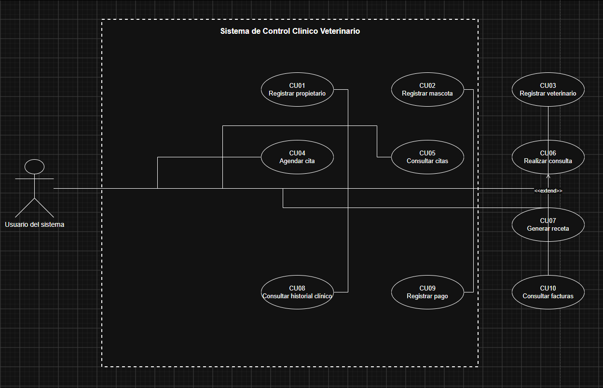
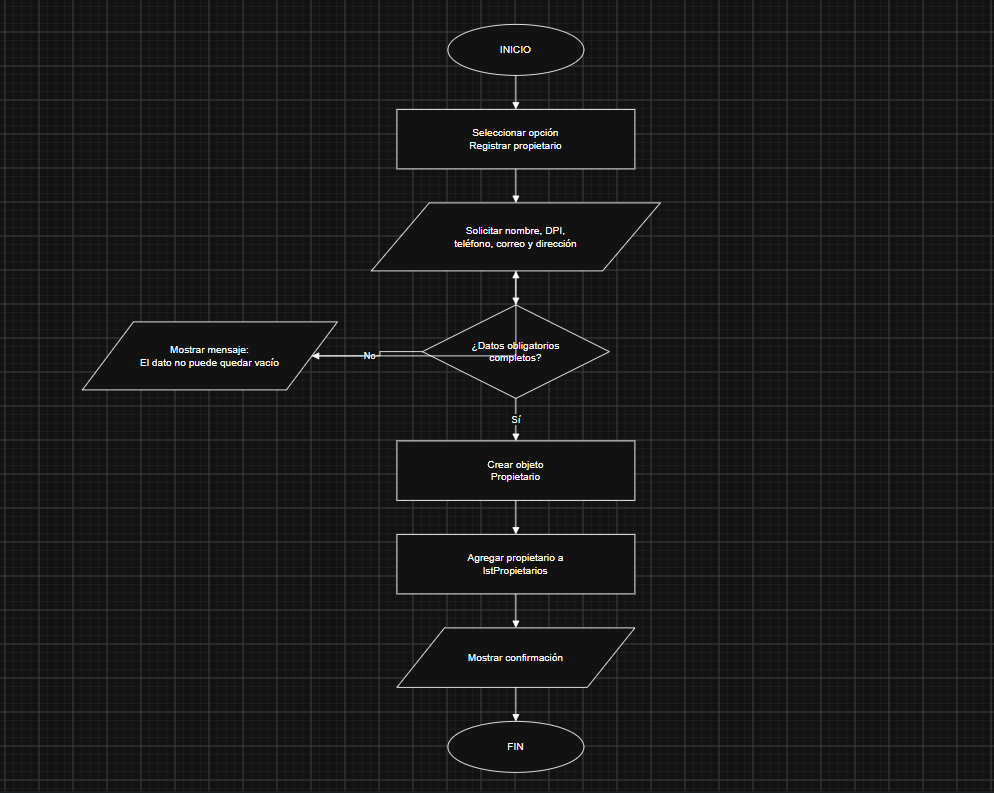
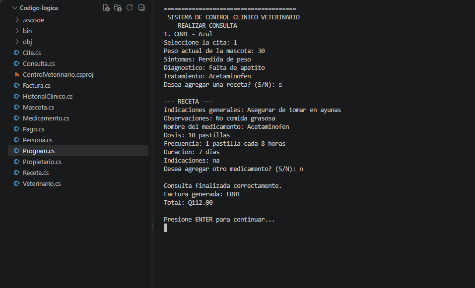
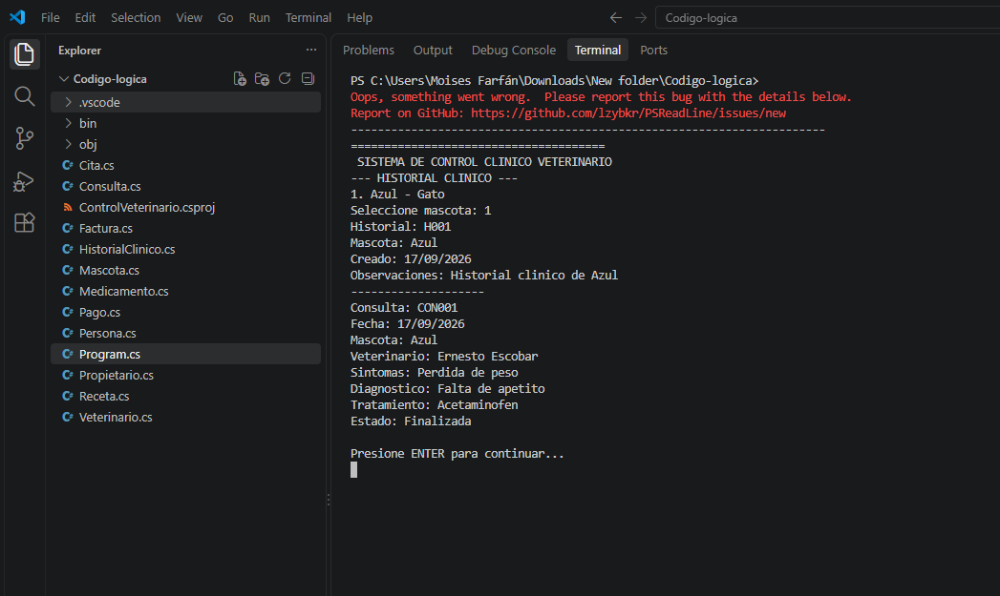

# Sistema de Control Clínico Veterinario

Proyecto desarrollado en **C#** como parte del curso de Programación 2.

El objetivo del proyecto es representar de forma sencilla y lógica el funcionamiento básico de una clínica veterinaria, utilizando conceptos de **Programación Orientada a Objetos (POO)** como clases, objetos, constructores, herencia, encapsulamiento, polimorfismo, métodos, propiedades, listas y relaciones entre objetos.


---

## Navegación rápida

- [Código del proyecto en C#](Codigo-logica/)
- [Diagramas de casos de uso](Diagramas/Casos_de_uso/)
- [Diagramas de flujo](Diagramas/Diagramas_de_flujo/)
- [Diagrama de clases en BlueJ](Diagramas/Diagrama_de_clases_BlueJ/)
- [Evidencias del proyecto](Evidencia/)

---

## Análisis del sistema

El sistema fue diseñado partiendo de una idea sencilla: observar el funcionamiento de una veterinaria como un escenario del mundo real e identificar los elementos que participan en ella.

A partir de ese análisis se identificaron entidades como:

- Propietario
- Mascota
- Veterinario
- Cita
- Consulta
- Historial clínico
- Receta
- Medicamento
- Factura
- Pago

Después se definieron las características de cada entidad, las acciones que podía realizar y las relaciones que existían entre ellas. Estas entidades fueron transformadas en clases dentro del proyecto.

Por ejemplo, una mascota tiene características como nombre, especie, raza, sexo, peso y color. Estas características se representan mediante propiedades. Las acciones, como actualizar el peso o mostrar la información, se representan mediante métodos.

El desarrollo del proyecto siguió de forma general el siguiente proceso:

1. Analizar el funcionamiento básico de una veterinaria.
2. Identificar las entidades principales.
3. Definir atributos y métodos.
4. Definir relaciones y cardinalidades.
5. Crear los diagramas.
6. Implementar las clases en C#.
7. Integrar las clases mediante el flujo principal del programa.
8. Realizar pruebas de funcionamiento.

---

## Organización del sistema

El programa se organizó en tres áreas principales para representar mejor las responsabilidades dentro de una veterinaria.

### Recepción

Desde esta sección se manejan las operaciones relacionadas con la atención inicial del cliente:

- Registrar propietario.
- Registrar mascota.
- Agendar citas.
- Consultar citas.
- Consultar facturas.
- Registrar pagos.

### Veterinario

Esta sección se utiliza para las operaciones relacionadas con la atención clínica:

- Consultar citas asignadas.
- Realizar consultas.
- Registrar diagnóstico y tratamiento.
- Generar recetas.
- Consultar historial clínico.

### Administración

Esta sección contiene las funciones administrativas relacionadas con el personal veterinario:

- Registrar veterinarios.
- Consultar veterinarios.

Esta separación representa una regla lógica del negocio: **no todas las áreas deben realizar las mismas funciones**. El proyecto no implementa un sistema completo de autenticación con usuarios y contraseñas, pero sí representa la separación de responsabilidades entre las diferentes áreas.

---

## Reglas de negocio consideradas

Durante el diseño del sistema se tomaron en cuenta varias reglas para mantener un flujo lógico:

- Una mascota debe estar relacionada con un propietario.
- Para agendar una cita deben existir un propietario, una mascota y un veterinario.
- La mascota seleccionada para una cita pertenece al propietario seleccionado.
- Una cita relaciona al propietario, la mascota y el veterinario.
- El veterinario trabaja con las citas que tiene asignadas.
- Una consulta se realiza a partir de una cita.
- Una consulta puede generar una receta.
- Una receta puede contener uno o varios medicamentos.
- Las consultas forman parte del historial clínico de la mascota.
- La factura se genera como parte del proceso posterior a la consulta.
- El pago se registra sobre una factura.

---

## Programación Orientada a Objetos

El proyecto utiliza varios conceptos estudiados durante el curso.

### Clases y objetos

Cada entidad principal del sistema se representa mediante una clase. Cuando el programa registra información concreta, se crean objetos a partir de esas clases.

Por ejemplo, `Mascota` es una clase y una mascota registrada en el sistema es un objeto de esa clase.

[Ver código de las clases](Codigo-logica/)

### Constructores

Los constructores permiten inicializar los objetos con la información necesaria desde el momento en que se crean.

### Herencia

Se creó la clase `Persona` para almacenar información común como nombre, DPI, teléfono, correo y dirección.

Las clases `Propietario` y `Veterinario` heredan de `Persona`, evitando repetir información común.

```text
Persona
├── Propietario
└── Veterinario
```

### Polimorfismo

El método `mostrarInformacion()` se define en `Persona` y puede ser sobrescrito por las clases hijas para mostrar información adicional según el tipo de objeto.

### Encapsulamiento y responsabilidades

Cada clase se encarga de la información y de los comportamientos relacionados con su responsabilidad.

Ejemplos:

- `Mascota` maneja información de la mascota.
- `Consulta` maneja información clínica.
- `Factura` maneja información financiera.
- `Cita` representa una atención programada.
- `HistorialClinico` almacena las consultas realizadas.

### Relaciones entre objetos

Las clases también se relacionan entre sí.

```text
Propietario 1 -------- 0..* Mascota
Mascota 1 ------------ 1 HistorialClinico
Mascota 1 ------------ 0..* Consulta
Veterinario 1 -------- 0..* Cita
Cita 1 --------------- 0..1 Consulta
Consulta 1 ----------- 0..1 Receta
Receta 1 ------------- 1..* Medicamento
Consulta 1 ----------- 1 Factura
Factura 1 ------------ 0..1 Pago
```

[Ver diagrama de clases en BlueJ](Diagramas/Diagrama_de_clases_BlueJ/)

---

## Casos de uso

Los diagramas de casos de uso representan las acciones que pueden realizar los diferentes actores o áreas dentro del sistema.

Entre los principales casos de uso se encuentran:

- Registrar propietario.
- Registrar mascota.
- Registrar veterinario.
- Agendar cita.
- Consultar citas.
- Realizar consulta.
- Generar receta.
- Consultar historial clínico.
- Consultar facturas.
- Registrar pago.

[Ver diagramas de casos de uso](Diagramas/Casos_de_uso/)

### Evidencia de caso de uso



---

## Diagramas de flujo

Los diagramas de flujo muestran el orden lógico de los procesos principales del sistema, incluyendo decisiones, validaciones y resultados.

Se documentaron procesos como registro de propietario, registro de mascota, registro de veterinario, agenda de citas, consultas, recetas, historial clínico, facturas y pagos.

[Ver diagramas de flujo](Diagramas/Diagramas_de_flujo/)

### Evidencia de diagrama de flujo



---

## Diagrama de clases

El diagrama de clases representa la estructura del sistema, incluyendo clases, atributos, métodos, herencia y relaciones.

El entregable correspondiente fue preparado para **BlueJ**.

[Ver proyecto del diagrama de clases en BlueJ](Diagramas/Diagrama_de_clases_BlueJ/)

---

## Evidencias del programa

Durante las pruebas se tomaron capturas para demostrar el funcionamiento de las diferentes partes del sistema.

[Ver todas las evidencias del programa](Evidencia/Programa/)

### Ejemplo: consulta del veterinario



### Ejemplo: historial clínico



---

## Videos explicativos

### Video 1 - Lógica y creación del proyecto

En este video se explica cómo se analizó el problema, cómo se identificaron las clases y cómo se aplicaron los conceptos de Programación Orientada a Objetos.

[](https://youtu.be/w4X_qkPQ_Xw)

### Video 2 - Demostración del sistema

En este video se muestra el funcionamiento del programa mediante una demostración del flujo principal.

[](https://youtu.be/ME0TAMpPsLU)

---

## Tecnologías utilizadas

- C#
- .NET
- Visual Studio Code
- PowerShell
- Draw.io
- BlueJ
- Git
- GitHub
- OBS Studio

---

## Ejecución del proyecto

Para ejecutar el programa es necesario tener instalado el SDK de .NET.

Desde PowerShell o una terminal, entrar a la carpeta del código:

```powershell
cd Codigo-logica
```

Compilar el proyecto:

```powershell
dotnet build
```

Ejecutar:

```powershell
dotnet run
```

---

## Estructura principal del proyecto

```text
Sitema_Veterinaria/
│
├── Codigo-logica/
│
├── Diagramas/
│   ├── Casos_de_uso/
│   ├── Diagramas_de_flujo/
│   └── Diagrama_de_clases_BlueJ/
│
├── Evidencia/
│   ├── BlueJ/
│   ├── Caso_de_Uso/
│   ├── Diagrama_flujo/
│   └── Programa/
│
└── README.md
```

---

## Conclusión

El proyecto fue desarrollado intentando que el código fuera consecuencia del análisis del problema y no al contrario.

Primero se identificaron las entidades del mundo real, después sus características, acciones y relaciones. Posteriormente se representaron mediante diagramas y finalmente se implementaron utilizando Programación Orientada a Objetos en C#.

El objetivo principal fue crear un sistema sencillo, pero con una estructura lógica que permitiera representar el flujo básico de una clínica veterinaria y aplicar los conceptos estudiados durante el curso.
