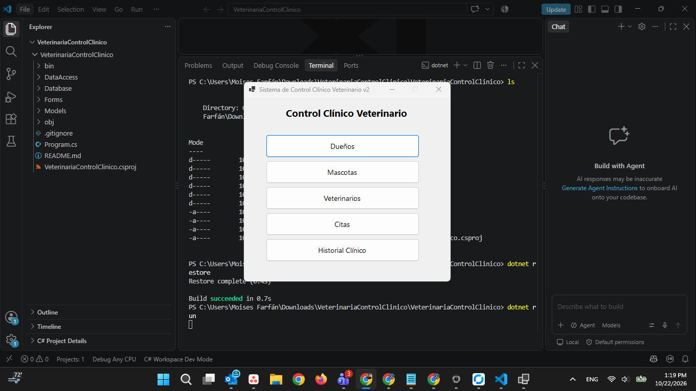
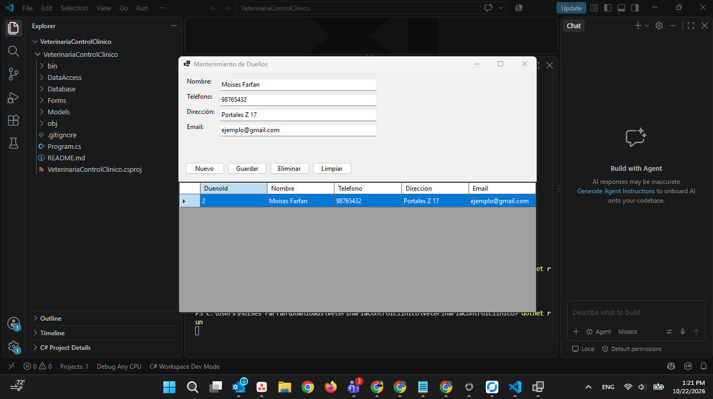
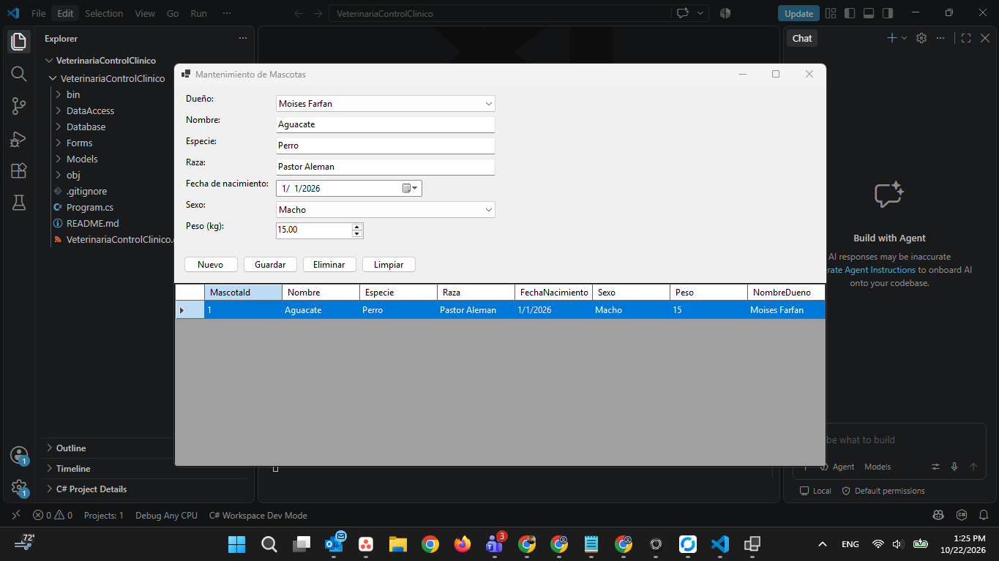
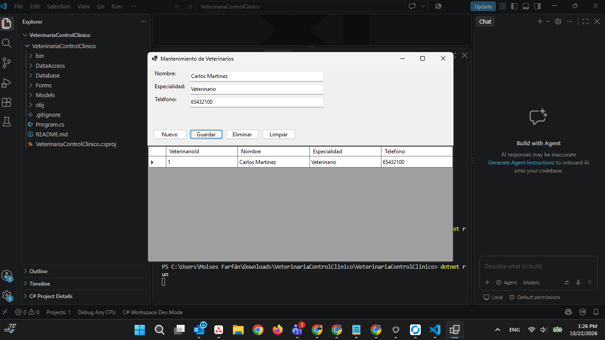
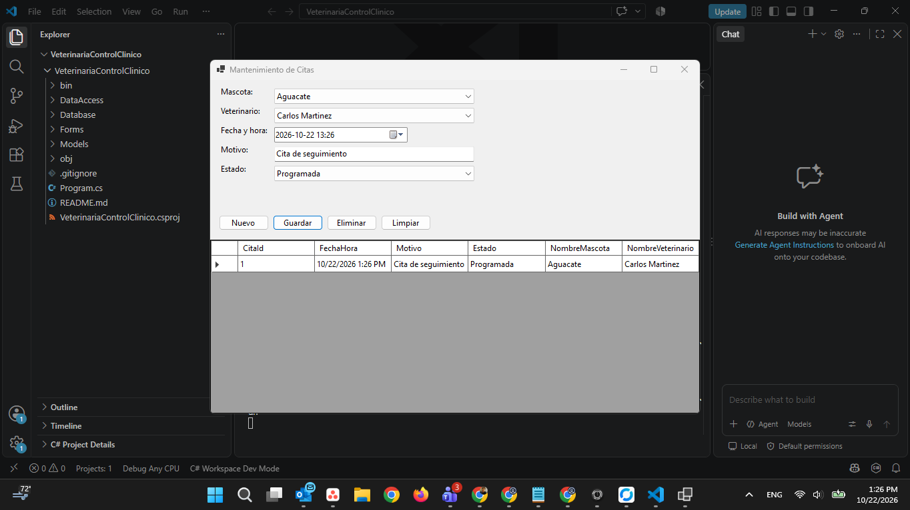
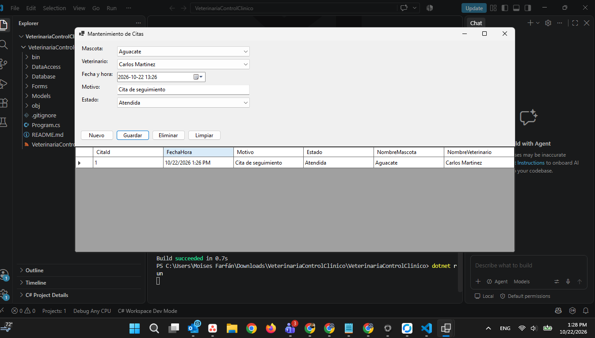
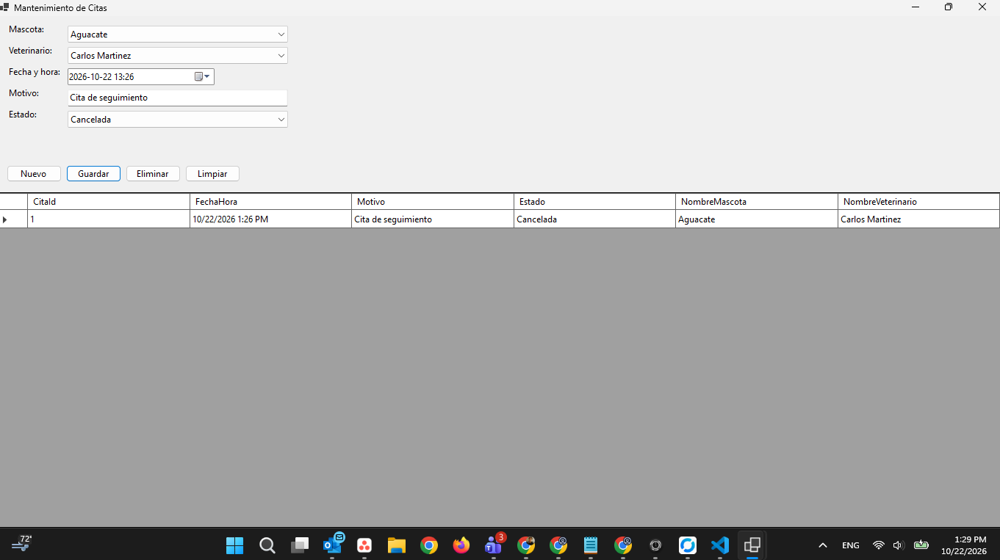
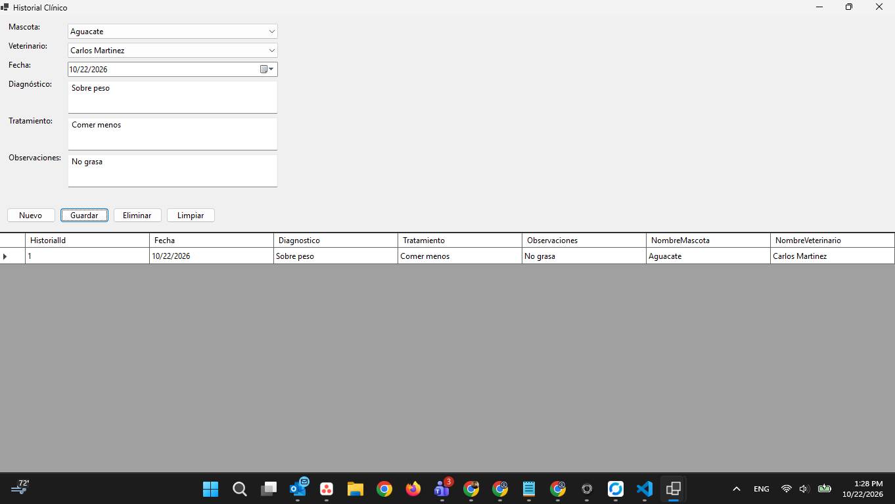

# 🐾 Sistema de Control Clínico Veterinario v2

## 📋 ¿Qué es este proyecto?

Es una aplicación de escritorio desarrollada en **C# (.NET, Windows Forms)**
que digitaliza el control administrativo y clínico de una veterinaria. Sustituye
el manejo en papel de dueños, mascotas, veterinarios, citas e historiales
médicos por una interfaz de escritorio conectada a una base de datos **SQLite**.

Pertenece al repositorio `Programacion_2`, dentro de la carpeta del proyecto
`VeterinariaControlClinico-2`.

## 🎯 Objetivo

Brindar a una clínica veterinaria una herramienta sencilla para:

- Registrar y mantener actualizada la información de **dueños** y **mascotas**.
- Llevar el control del personal de **veterinarios** disponible.
- **Agendar, atender y cancelar citas**.
- Mantener un **historial clínico** por mascota, con diagnóstico y tratamiento
  de cada consulta.

## ⚙️ ¿Qué hace el sistema?

| Módulo | Funcionalidad |
|---|---|
| **Dueños** | Alta, consulta, edición y baja de clientes (nombre, teléfono, dirección, email) |
| **Mascotas** | Registro de mascotas asociadas a un dueño (especie, raza, fecha de nacimiento, sexo, peso) |
| **Veterinarios** | Control del personal médico (nombre, especialidad, teléfono) |
| **Citas** | Agendar citas entre una mascota y un veterinario, con motivo y estado (Programada / Atendida / Cancelada) |
| **Historial Clínico** | Registro de diagnóstico, tratamiento y observaciones de cada consulta realizada |

Cada módulo cuenta con su propio formulario con operaciones **CRUD** completas:
crear, listar, actualizar y eliminar registros.

## 🗂️ Estructura del proyecto

```
VeterinariaControlClinico-2/
├── Program.cs                     # Punto de entrada de la aplicación
├── Database/
│   └── DatabaseHelper.cs          # Conexión y creación de tablas SQLite
├── Models/                        # Entidades del sistema
│   ├── Dueno.cs
│   ├── Veterinario.cs
│   ├── Mascota.cs
│   ├── Cita.cs
│   └── HistorialClinico.cs
├── DataAccess/                    # Métodos CRUD (una clase DAO por tabla)
│   ├── DuenoDAO.cs
│   ├── VeterinarioDAO.cs
│   ├── MascotaDAO.cs
│   ├── CitaDAO.cs
│   └── HistorialDAO.cs
├── Forms/                         # Formularios de Windows Forms
│   ├── FormPrincipal.cs           # Menú principal
│   ├── FormDuenos.cs
│   ├── FormMascotas.cs
│   ├── FormVeterinarios.cs
│   ├── FormCitas.cs
│   └── FormHistorial.cs
├── evidencias/                    # Capturas de pantalla del sistema en funcionamiento
├── README.md
└── VeterinariaControlClinico.csproj
```

## 🧩 Organización del proyecto

El proyecto sigue una separación por capas, típica de una aplicación de
escritorio con base de datos:

1. **`Database/`** — motor y esquema: abre la conexión SQLite y crea las
   tablas (`Duenos`, `Veterinarios`, `Mascotas`, `Citas`, `HistorialClinico`)
   la primera vez que se ejecuta el programa.
2. **`Models/`** — clases planas (POCO) que representan cada entidad del
   sistema, sin lógica de negocio.
3. **`DataAccess/`** — una clase DAO por entidad, con los métodos CRUD
   (`Crear`, `ObtenerTodos`, `ObtenerPorId`, `Actualizar`, `Eliminar`) que
   ejecutan las consultas SQL contra la base de datos.
4. **`Forms/`** — la interfaz gráfica: cada formulario consume los métodos
   del DAO correspondiente para mostrar, capturar y modificar datos.

Esta separación permite que, si cambia la forma en que se guardan los datos
o se agrega una nueva pantalla, los demás componentes no se vean afectados.

## 🛠️ Tecnologías utilizadas

- **C# / .NET** (Windows Forms)
- **SQLite** como motor de base de datos
- **Microsoft.Data.Sqlite** como proveedor de acceso a datos
- **Git / GitHub** para el control de versiones

## ▶️ Cómo ejecutarlo

1. Abrir `VeterinariaControlClinico.csproj` en Visual Studio.
2. Restaurar los paquetes NuGet (`Microsoft.Data.Sqlite` se descarga solo).
3. Ejecutar con F5. Al iniciar, la aplicación crea automáticamente el archivo
   `VeterinariaControlClinico.db` con todas las tablas si no existe.

Orden recomendado de captura para que los combos tengan datos: **Dueños →
Veterinarios → Mascotas → Citas / Historial Clínico**.

## 🖼️ Evidencias

Capturas del sistema en funcionamiento, disponibles en la carpeta
[`Pruebas/`](./Pruebas):

| Evidencia | Descripción |
|---|---|
|  | Pantalla principal del sistema |
|  | Registro de un nuevo dueño |
|  | Registro de una nueva mascota |
|  | Registro de un nuevo veterinario |
|  | Agendamiento de una cita |
|  | Cita marcada como atendida |
|  | Cita marcada como cancelada |
|  | Registro del historial clínico de una mascota |

## 📌 Repositorio

Este proyecto forma parte del repositorio
[`Programacion_2`](https://github.com/moisesafarfan/Programacion_2), dentro
de la carpeta `VeterinariaControlClinico-2`.
